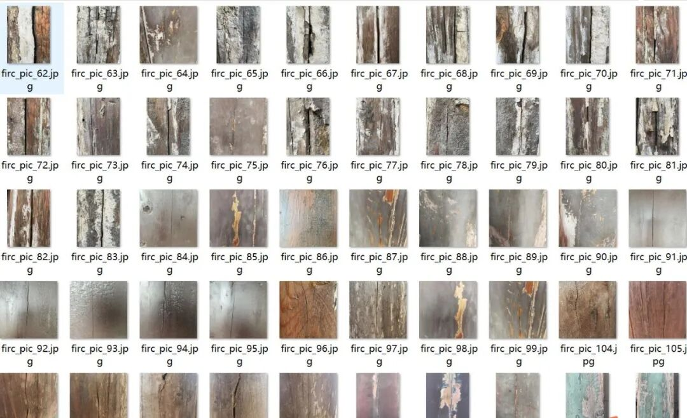
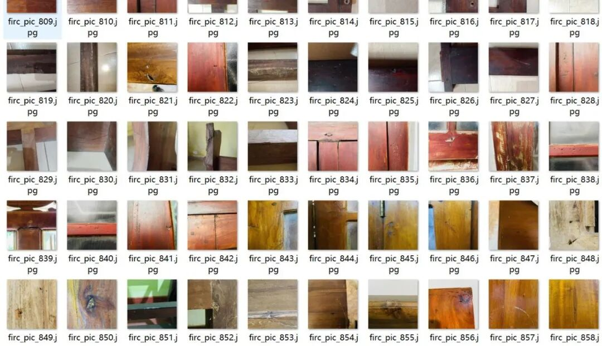
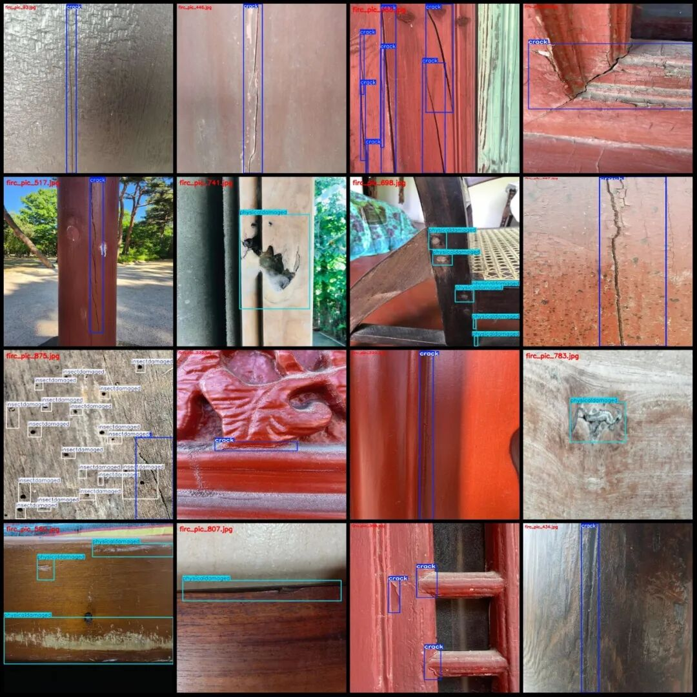
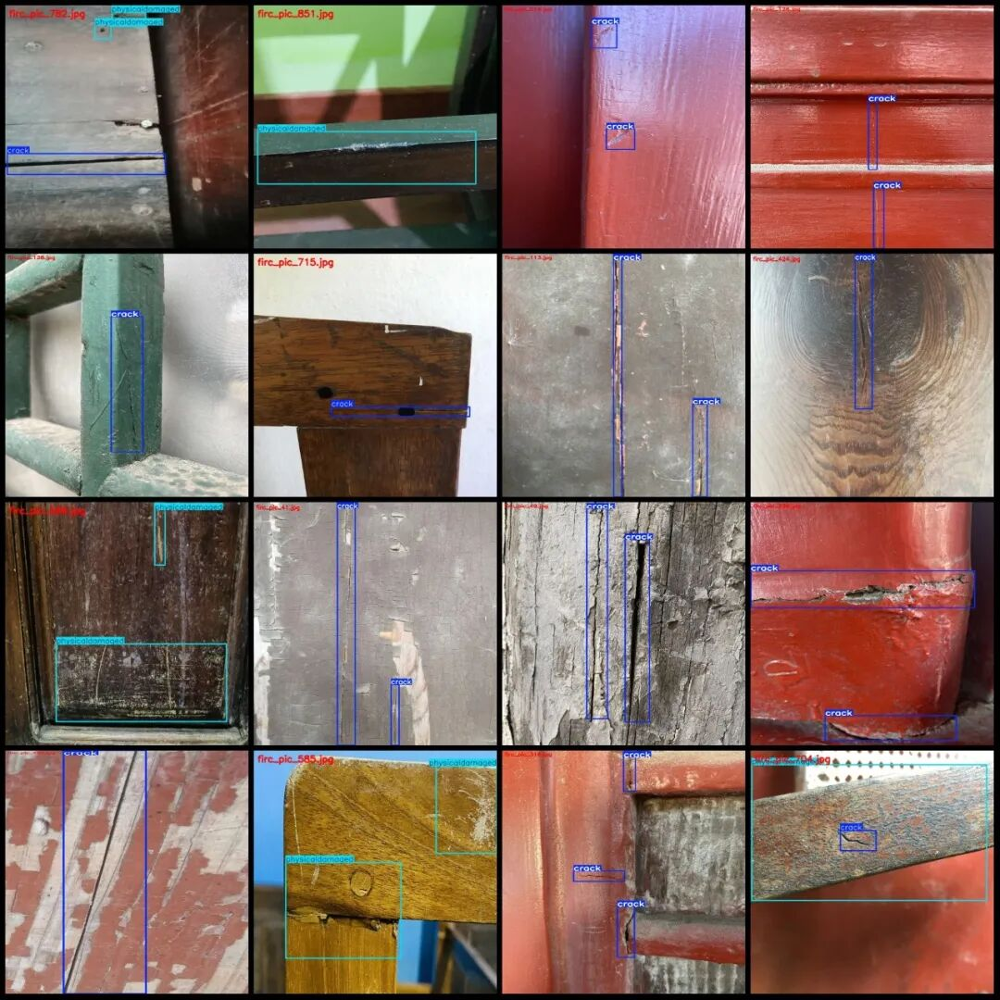
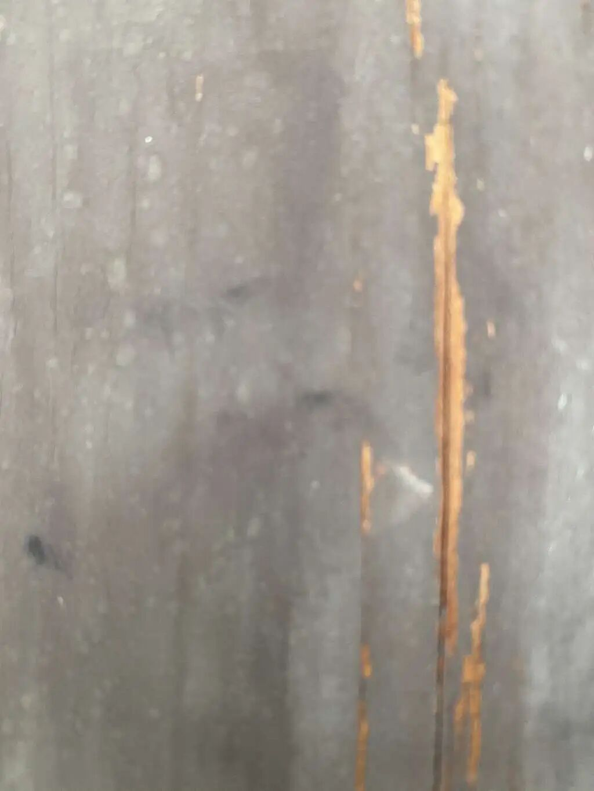
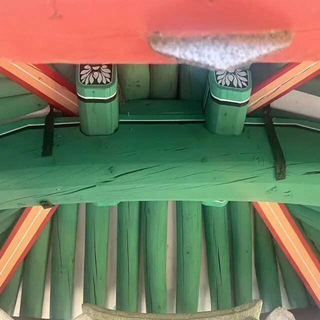

# Dataset for Detecting Defects in Ancient Architectural Wood Structures in VOC+YOLO format with 863 images and 3 categories

Dataset format: Pascal VOC format + YOLO format (txt file without split path, only containing jpg images and corresponding VOC format xml files and yolo format txt files)

Number of images (number of jpg files): 863

Number of annotations (number of xml files): 863

Number of annotations (number of txt files): 863

Label category count: 3

Label category names (note that the order of categories in the YOLO format does not correspond to this, but is based on the labels folder's classes.txt): ["crack", "insectdamaged", "physicaldamaged"]

Number of boxes and the number of images occupied by each category:

Crack (cracks) Frames = 1196, Pictures = 606

Insect damaged (insect damage) Frames = 371, Pictures = 50

Physically damaged (physical damage) Frames = 723, Pictures occupied = 289

Total frame count: 2290

Image resolution: Multi-resolution images, such as 1024x1365, 640x640, etc.

Using labelImg:

Annotation rules: Draw a rectangle around the category.

Important Notice: The dataset does not have separate training, validation, and test sets; you need to partition them yourself.

Special : This dataset does not guarantee the accuracy of the trained models or weight files.

Image Preview:

Annotation example:

Single image:

## Payment

Here is a pay link on Stripe ( https://buy.stripe.com/3cs8yP7sY87d0vu9AB ). Please contact me lonlonago@foxmail.com after funding $89, and I will send you a complete data files , thank you!

